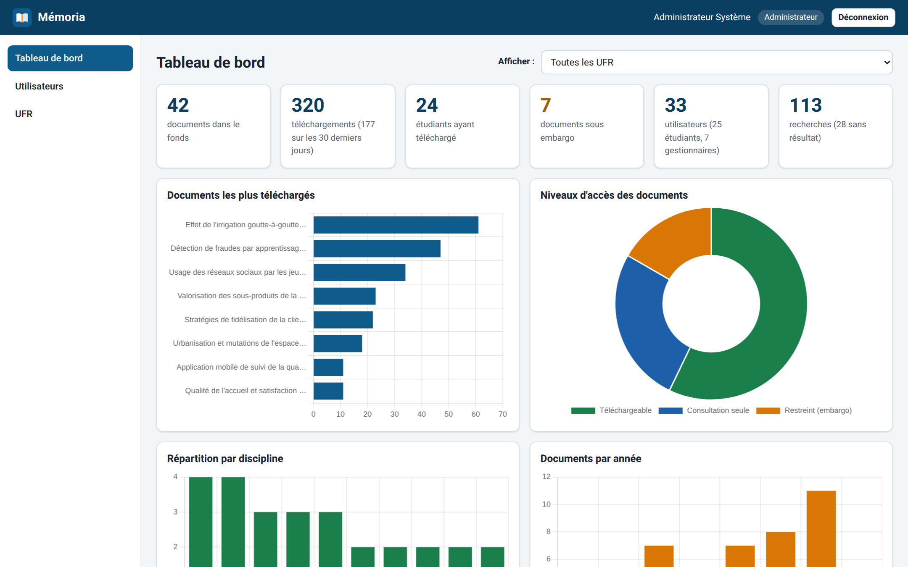
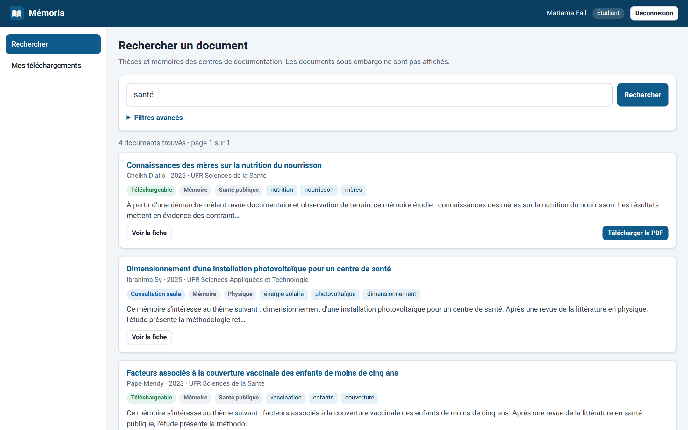
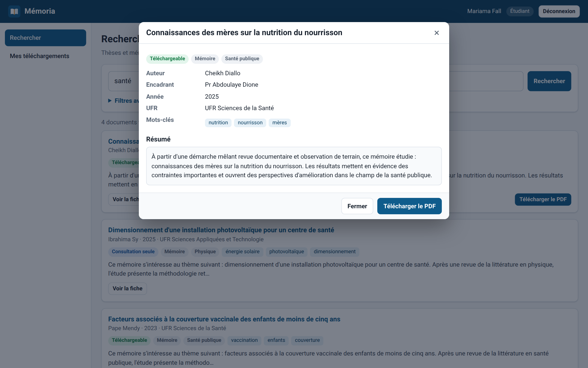
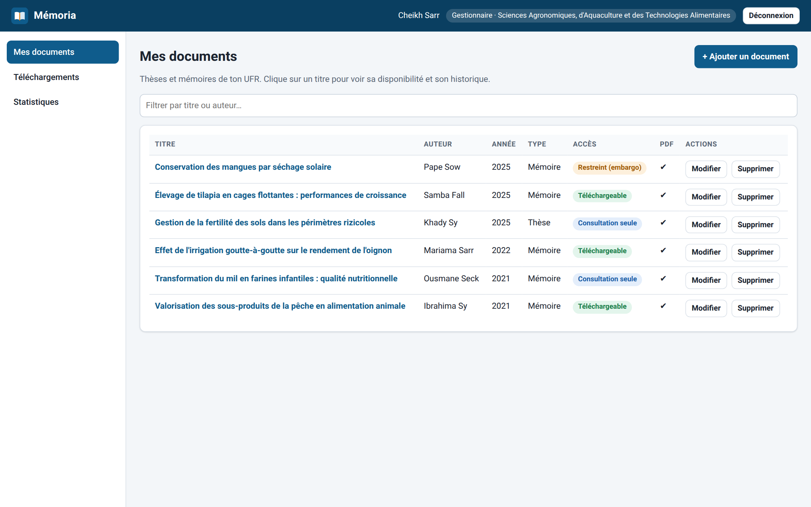
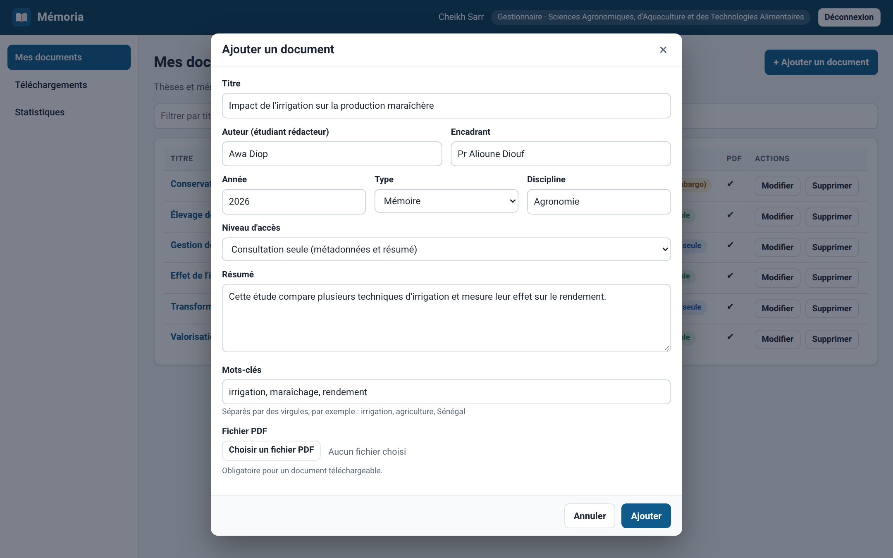
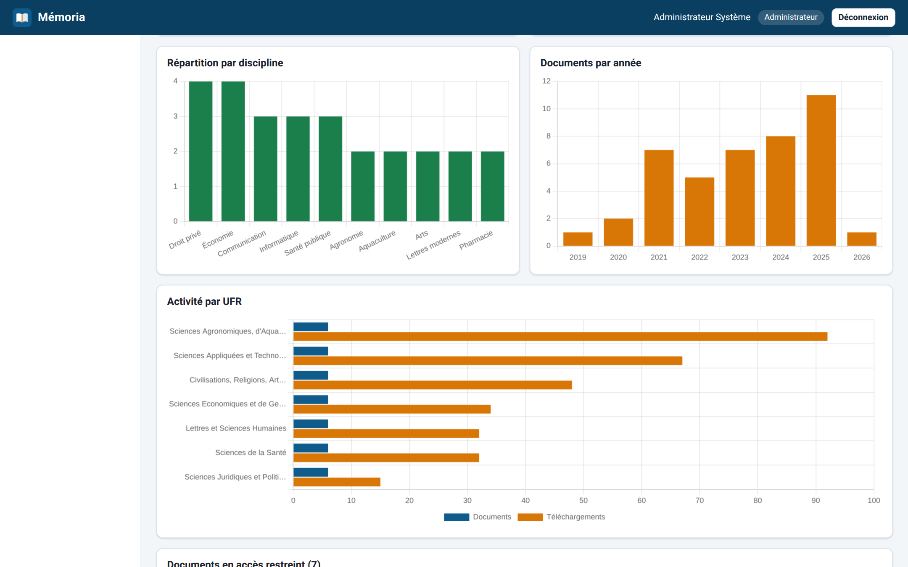
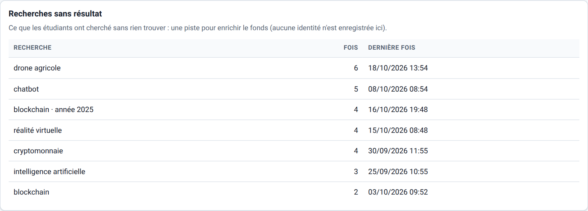
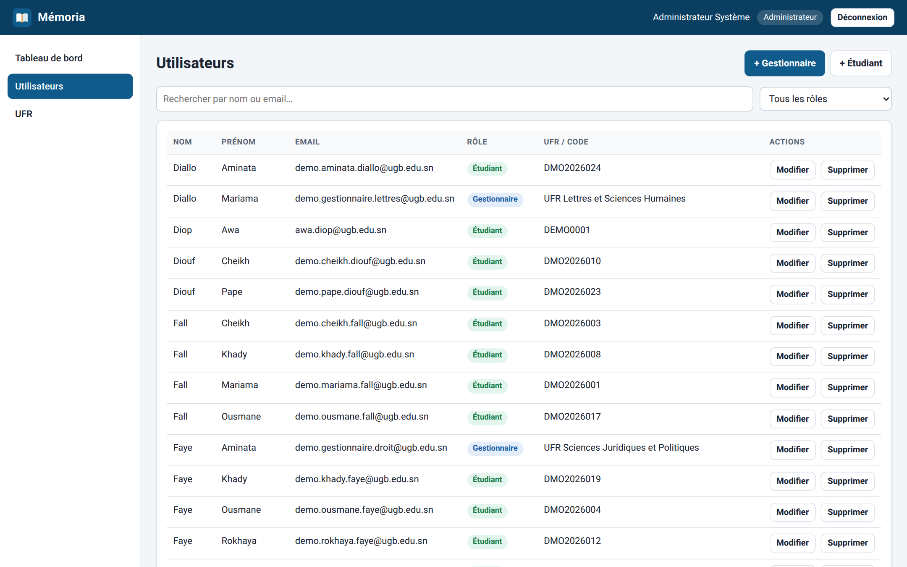
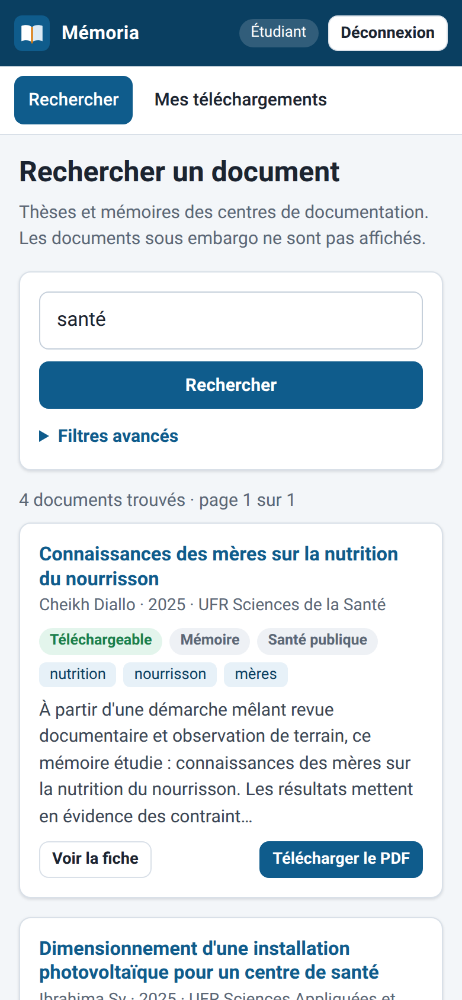
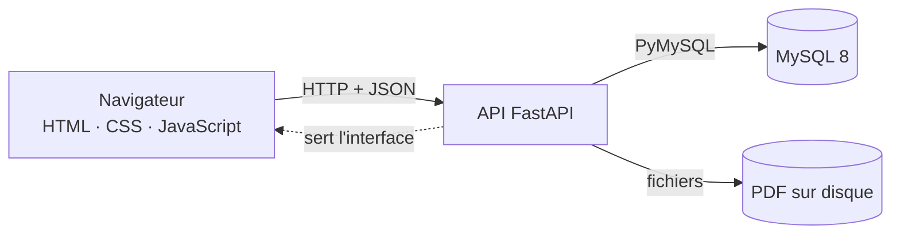

<p align="center">
  
</p>

<h1 align="center">Mémoria</h1>

**Démo en ligne : https://memoria-e76r.onrender.com** (les comptes de test sont affichés sur la page de connexion ; la première ouverture peut prendre 30 à 50 secondes, le temps que le serveur se réveille.)

<p align="center">
  Plateforme de gestion et de recherche des thèses et mémoires<br>
  pour les centres de documentation universitaires.
</p>

<p align="center">
  <a href="https://github.com/aminetou-kane/memoria/actions/workflows/tests.yml"></a>
  
  
  
  
</p>



## Présentation

Mémoria permet aux **gestionnaires** d'un centre de documentation d'enregistrer et d'organiser les thèses et mémoires de leur UFR, de choisir pour chaque document un niveau d'accès, et aux **étudiants** de les rechercher et de les télécharger lorsque les droits le permettent. Les **administrateurs** gèrent les comptes et suivent l'activité grâce à un tableau de bord statistique.

Trois niveaux d'accès protègent les documents :

| Niveau | Ce que voit l'étudiant |
|---|---|
| `TELECHARGEABLE` | la fiche complète et le PDF |
| `CONSULTATION_SEULE` | les métadonnées et le résumé, sans le PDF |
| `RESTREINT` (embargo) | rien : le document n'est ni listé, ni consultable, ni téléchargeable |

## Fonctionnalités

| Rôle | Ce qu'il peut faire |
|---|---|
| **Étudiant** | rechercher par texte libre ou par filtres (titre, auteur, mot-clé, année, UFR, discipline, type), ouvrir une fiche, télécharger un PDF autorisé, consulter son historique |
| **Gestionnaire** | ajouter, modifier et supprimer les documents **de son UFR** (avec PDF), choisir le niveau d'accès, voir la disponibilité et l'historique des téléchargements, consulter les statistiques de son UFR |
| **Administrateur** | gérer les UFR, les gestionnaires et les étudiants ; tableau de bord global (chiffres clés, graphiques, recherches sans résultat) ; exports CSV compatibles Excel |

## Captures d'écran

| | |
|---|---|
|  **Connexion** |  **Recherche étudiant** |
|  **Fiche d'un document** |  **Gestion des documents** |
|  **Ajout d'un document** |  **Statistiques** |
|  **Recherches sans résultat** |  **Gestion des comptes** |

<p align="center">
  <br>
  <em>L'interface s'adapte aux écrans de téléphone.</em>
</p>

## Architecture



L'application est volontairement simple à installer : **une seule commande** lance l'API et l'interface, sans Docker, sans Node.js et sans étape de compilation.

## Stack technique

| Couche | Technologies |
|---|---|
| Serveur | Python, FastAPI, Uvicorn |
| Base de données | MySQL 8 (PyMySQL, requêtes SQL paramétrées) |
| Authentification | jetons JWT, mots de passe hachés avec bcrypt |
| Interface | HTML, CSS et JavaScript sans framework, Chart.js pour les graphiques |
| Tests | pytest contre une vraie base MySQL, GitHub Actions |

## Sécurité et qualité

- **Rôles vérifiés côté serveur** sur chaque route : un gestionnaire ne peut agir que sur les documents de son UFR.
- **Requêtes SQL paramétrées** ; les rares noms de colonnes dynamiques proviennent de listes blanches.
- **Interface protégée contre l'injection de code (XSS)** : aucune donnée n'est insérée comme du HTML.
- **Fichiers téléversés contrôlés** : signature PDF et taille vérifiées, noms de fichiers aléatoires.
- **Exports CSV protégés** contre l'injection de formules Excel.
- **Règles métier explicites** : chaque règle violée lève une exception dédiée et renvoie un message JSON clair.
- **29 tests automatisés**, exécutés à chaque envoi sur GitHub.

> Projet de démonstration : avant tout déploiement avec de vraies données, il faudrait en plus limiter les tentatives de connexion, activer HTTPS et remplacer les mots de passe et le secret JWT par défaut.

## Démarrage rapide

**Prérequis** : Python 3.10 ou plus, MySQL 8.0 ou plus (par exemple via WAMP ou XAMPP), Git.

```bash
git clone https://github.com/aminetou-kane/memoria.git
cd memoria
```

**1. Créer la base de données** : importer `db/01_schema.sql` puis `db/02_seed.sql` (dans phpMyAdmin, onglet *Importer*, ou en ligne de commande : `mysql -u root -p < db/01_schema.sql`).

**2. Installer et lancer l'application** (Windows) :

```bat
cd backend
python -m venv .venv
.venv\Scripts\activate
pip install -r requirements.txt
copy .env.example .env
uvicorn app.main:app --reload
```

Sous Linux ou macOS : `source .venv/bin/activate` et `cp .env.example .env`.

**3. Ouvrir** http://127.0.0.1:8000. La documentation interactive de l'API est sur http://127.0.0.1:8000/docs.

Dans `backend/.env` : renseigner `DB_PASSWORD` si ton MySQL a un mot de passe, et **changer `ADMIN_PASSWORD` et `JWT_SECRET`**. Le compte administrateur est créé au premier démarrage avec l'email et le mot de passe de ce fichier. Le nom affiché dans l'interface se règle avec `APP_NOM` et `APP_SOUS_TITRE`.

## Données de démonstration

Un programme crée des données **entièrement fictives** (7 gestionnaires, 24 étudiants, 42 documents avec PDF, 320 téléchargements et une centaine de recherches sur 90 jours) pour explorer l'application avec un tableau de bord bien rempli :

```bat
python scripts\donnees_demo.py charger
python scripts\donnees_demo.py supprimer
```

- Gestionnaires : `demo.gestionnaire.<sat|lettres|droit|eco|sante|civ|agro>@ugb.edu.sn`, mot de passe `Demo2026!`.
- Étudiant d'exemple : Mariama Fall, `demo.mariama.fall@ugb.edu.sn`, code `DMO2026001`.
- Seuls les comptes commençant par `demo.` sont créés puis supprimés : le reste de la base n'est jamais touché.
- Les captures d'écran de ce dépôt se régénèrent avec `pip install playwright` puis `python scripts\captures.py` (Microsoft Edge ou Chrome requis).

## Déploiement en ligne (démonstration)

L'application est prévue pour une démonstration publique : avec `DEMO_MODE=true`, la page de connexion affiche un encadré **Comptes de test** (étudiant, gestionnaire, administrateur) et un recruteur peut tout essayer sans créer de compte. Au démarrage, l'application crée elle-même les tables et charge les données fictives.

Une configuration gratuite possible : **Render** pour l'application (Dockerfile + `render.yaml` fournis) et **TiDB Cloud Serverless** pour la base (compatible MySQL).

1. **Base de données** : créer un cluster TiDB Cloud Serverless, puis un utilisateur et une base nommée `memoria`. Noter l'hôte, le port (4000), l'utilisateur et le mot de passe.
2. **Application** : sur Render, *New > Blueprint*, choisir ce dépôt. Renseigner `DB_HOST`, `DB_USER` et `DB_PASSWORD`. `DEMO_MODE`, `DB_SSL` et `JWT_SECRET` sont déjà réglés par `render.yaml`.
3. Ouvrir l'adresse fournie par Render : au premier démarrage, la base est initialisée (environ une minute).

Points à connaître :

- Le plan gratuit de Render met l'application en veille après 15 minutes sans visite : la première requête suivante prend quelques dizaines de secondes. Le disque est aussi effacé au redémarrage ; les PDF fictifs sont donc régénérés automatiquement au démarrage.
- Les comptes de test sont publics : ne jamais activer `DEMO_MODE` sur une base contenant de vraies données.
- Hors démonstration, laisser `DEMO_MODE=false` et choisir un vrai mot de passe administrateur.

## Tests

```bat
cd backend
pip install -r requirements-dev.txt
pytest
```

La base MySQL doit être démarrée et importée. Les tests créent leurs propres données et les suppriment ensuite.

## Structure du projet

```text
memoria/
├── backend/
│   ├── app/
│   │   ├── routers/        # authentification, utilisateurs, UFR, documents, recherche, statistiques
│   │   ├── static/         # interface web : HTML, CSS, JavaScript, logo, Chart.js
│   │   └── *.py            # configuration, base de données, sécurité, validation, exceptions
│   ├── scripts/            # données de démonstration et captures automatiques
│   ├── tests/              # tests automatisés
│   ├── requirements.txt
│   └── .env.example
├── db/                     # scripts SQL (schéma et données initiales)
├── docs/                   # documentation de l'API et captures d'écran
└── .github/workflows/      # tests automatiques
```

## Documentation de l'API

La liste complète des routes, des paramètres de recherche et des statistiques est dans [docs/API.md](docs/API.md).

## Feuille de route

- [x] Comptes, rôles et UFR
- [x] Fonds documentaire avec niveaux d'accès et téléchargements
- [x] Recherche multi-critères
- [x] Statistiques et exports CSV
- [x] Interface web pour les trois rôles
- [x] Données de démonstration et captures automatiques
- [ ] Recherche sémantique (par le sens)
- [ ] Résumé automatique des documents
- [ ] Assistant de questions-réponses avec citations, respectant les droits d'accès
- [x] Déploiement en ligne (mode démonstration avec comptes de test)

## Contexte du projet

Mémoria est un projet personnel réalisé dans le cadre de ma formation (Licence 3 Informatique, spécialité Systèmes d'information, Université Gaston Berger de Saint-Louis). Il reprend le périmètre fonctionnel d'un sujet académique de gestion des thèses et mémoires (rôles, niveaux d'accès, règles métier) et le réimplémente avec une architecture web moderne. Ce n'est pas un service officiel de l'université. **Toutes les données de démonstration (noms, titres, résumés, documents) sont fictives.**

## Auteur

**Aminetou Kane** · [GitHub](https://github.com/aminetou-kane) · [LinkedIn](https://www.linkedin.com/in/aminetou-kane-0b05a12a7)

## Licence

[MIT](LICENSE). Chart.js (licence MIT) est embarqué dans `backend/app/static/vendor/`.
